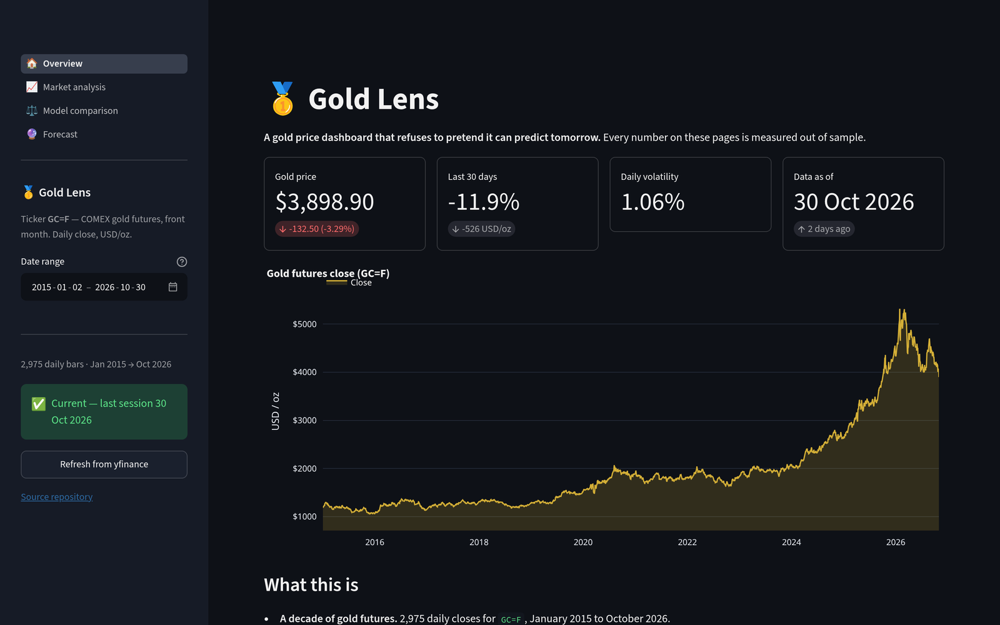
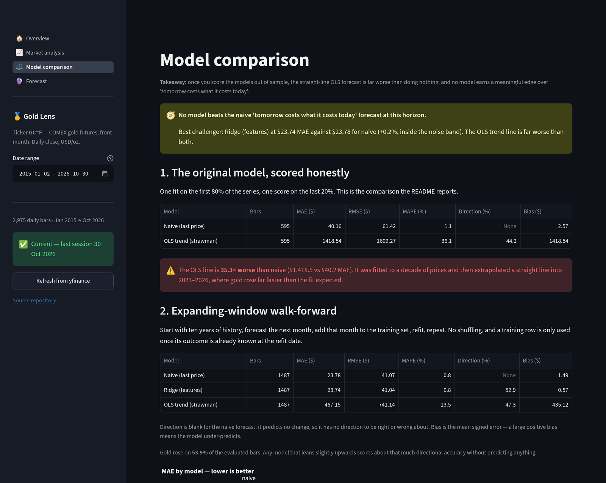
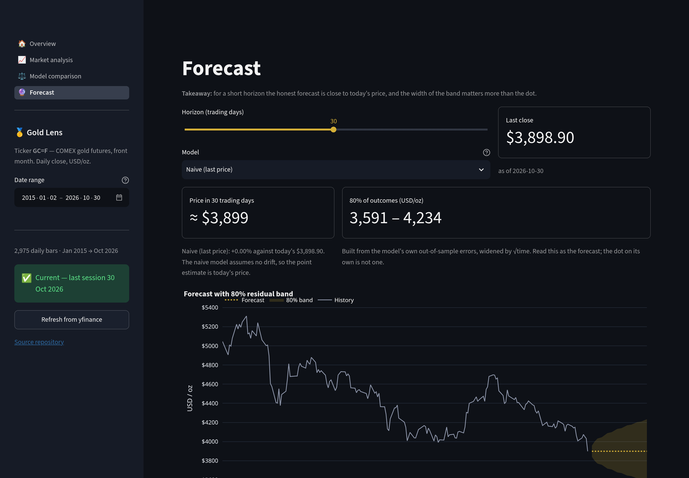
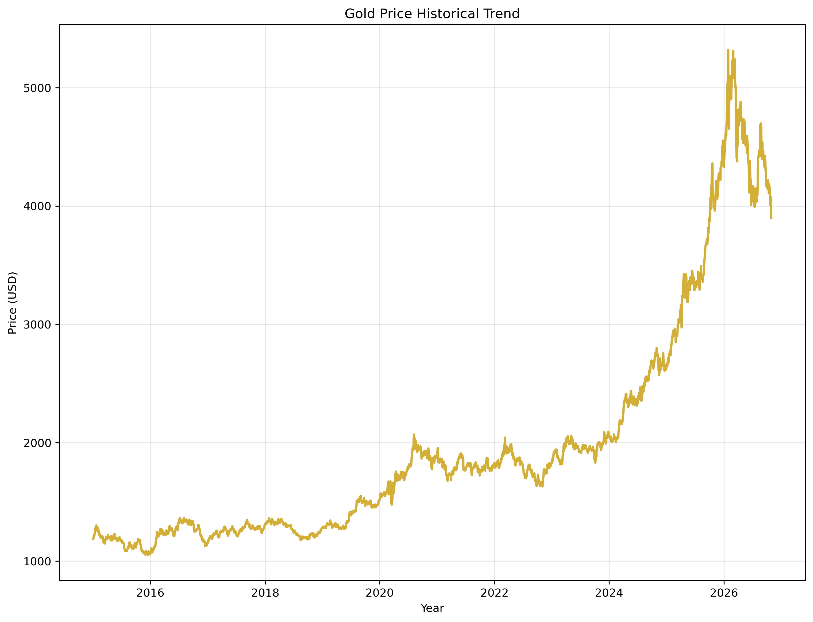
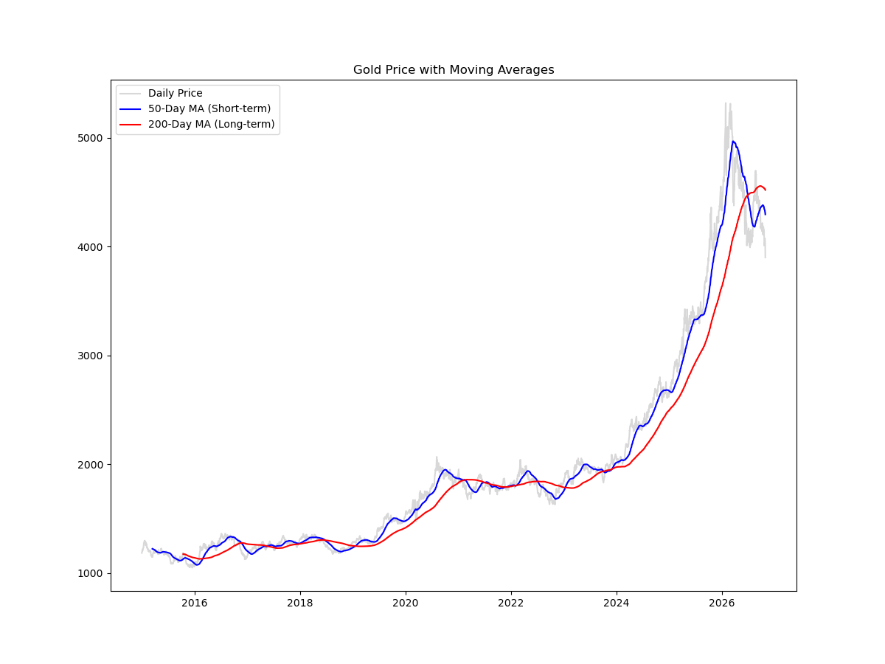
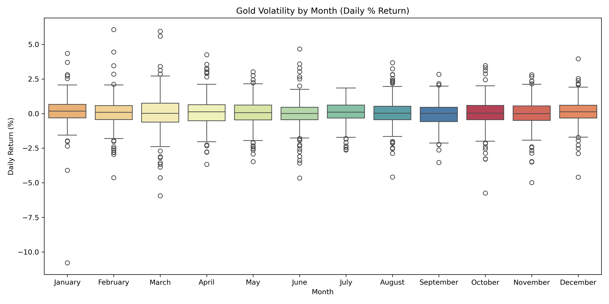
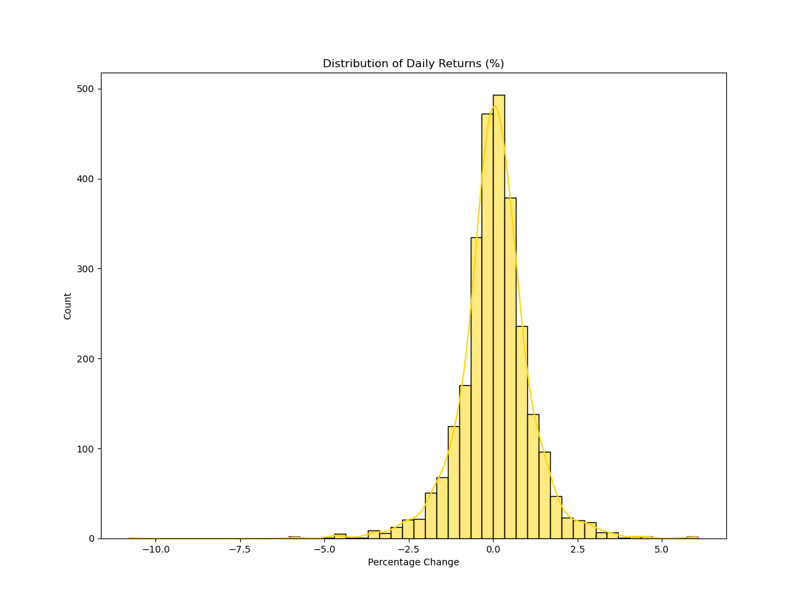
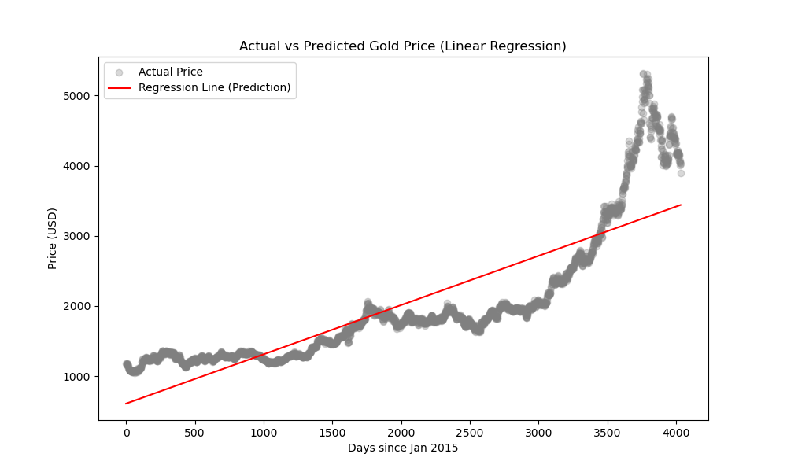

# Gold Price Analysis & Prediction

An analysis of COMEX gold futures (`GC=F`) that is honest about what a
time-series model can and cannot do. It ships a Streamlit app, a leakage-free
walk-forward evaluation, and a cautionary baseline: the original "prediction"
in this repository is a straight line that is **35.3× worse than doing
nothing**.

## What the app does

- **Market analysis** — trend, MA50/MA200 crossovers, monthly seasonality,
  return distribution, all filtered by a date range.
- **Model comparison** — the same models scored two ways: a single
  chronological holdout, and an expanding-window walk-forward with no
  shuffling and no leakage.
- **Forecast** — a point estimate and a residual-based 80% band for 1–60
  trading days ahead, with the reason the band is wide written next to it.

Every page states its takeaway in one sentence, including the uncomfortable
one: at a one-day horizon nothing here beats "tomorrow costs what it costs
today".

## Run it

```bash
python -m venv .venv
source .venv/bin/activate
pip install -r requirements.txt

streamlit run app/Home.py
```

Then open <http://localhost:8501>. The app reads the committed CSV at
`data/process/cleaned_gold_price_data.csv`; it never downloads anything at
start-up.

Reproduce the numbers without the UI:

```bash
python -m src.model          # holdout audit + walk-forward table
python scripts/smoke_check.py # data, page imports, app render, date filter
python scripts/leakage_check.py # proves the harness still catches look-ahead
```

## Deploying to Streamlit Community Cloud

Point the app at `app/Home.py` with `main` as the branch; `requirements.txt` is
picked up automatically. Two things bit this project there and are worth
knowing before you deploy:

- **A running server does not reload imported packages.** Streamlit re-executes
  the entry script when the repo changes, but anything already in
  `sys.modules` stays as it was — so importing a *new* name from an existing
  package fails with `ImportError: cannot import name ... from 'lib'` until the
  process restarts. That is why `md_safe()` lives in its own module: a submodule
  that did not exist before is always read from disk, so a half-reloaded server
  keeps working. For any other case, **Manage app → Reboot** is the fix.
- **The committed CSV is what Cloud reads.** The in-app refresh button writes to
  the container's filesystem, which is discarded on the next restart. To update
  the deployed data, run `python -m src.data_cleaning` locally and commit the
  result.

## The app, page by page

### Overview



The landing page leads with the price, the day's move, the 30-day change, daily
volatility and — deliberately — **how old the data is**. The sidebar shows a
freshness chip and a **Refresh from yfinance** button, because a dashboard that
quietly displays an eight-month-old close is worse than one that admits it.

### Model comparison



Both tables on one page: the single chronological holdout that produces the
headline, and the expanding-window walk-forward that produces the verdict. The
banner states the result before the tables do, so nobody has to hunt for it.

### Forecast



The point estimate is intentionally underwhelming — the naive model assumes no
drift, so "in 30 trading days" is roughly today's price. The card that carries
the information is the 80% band beside it, built from the model's own
out-of-sample errors and widened by √time.

## The honest model comparison

**Single chronological holdout** (fit on the first 80%, score the last 20% —
595 bars):

| Predictor | MAE | MAPE |
|---|---|---|
| Naive (tomorrow = today) | $40.16 | 1.05% |
| OLS straight line on `days_since_start` | $1,418.54 | 36.11% |

The OLS line is **35.3× worse** than the naive forecast. It is kept in the app
as a cautionary baseline, not as a model.

**Expanding-window walk-forward** (refit every 21 bars, 1,487 evaluated bars,
2020-12-02 → 2026-10-29):

| Model | MAE | RMSE | MAPE | Direction |
|---|---|---|---|---|
| Naive (last price) | $23.78 | $41.07 | 0.83% | — |
| Ridge on lagged returns, MA gap, volatility | $23.74 | $41.04 | 0.83% | 52.9% |
| HistGradientBoosting (same features) | $24.34 | $42.40 | 0.85% | 50.6% |
| OLS trend (strawman) | $467.15 | $741.14 | 13.49% | 47.3% |

Ridge "wins" by $0.04 per bar, which is noise. Its 52.9% directional accuracy
sits *below* the share of up-days in the window (53.9%), so it is not evidence
of skill either. **Verdict: no model beats naive at a 1-day horizon.** The
boosting model is excluded from the default comparison because it loses.

## Project structure

```
data/
  process/cleaned_gold_price_data.csv   # committed, 2,975 rows, 2015-01-02 → 2026-10-30
  create_data.py                        # raw download helper
notebooks/exploration.ipynb             # the original EDA and the OLS plot
src/
  data_cleaning.py                      # download + normalise yfinance layouts
  model.py                              # features, walk-forward, metrics, forecast
app/
  Home.py                               # entry point, sidebar shell, landing page
  lib/__init__.py                       # repo root only - keep it that way
  lib/text.py                           # md_safe() - $ escaping for Markdown
  lib/data.py                           # cached loaders (no I/O at import)
  lib/charts.py                         # plotly builders
  pages/1_Analysis.py
  pages/2_Model_Comparison.py
  pages/3_Forecast.py
images/                                 # figures referenced below
scripts/smoke_check.py                  # headless verification
scripts/leakage_check.py                # look-ahead regression probe
.streamlit/config.toml                  # dark theme, gold accent
```

## Rebuilding the data

`data/raw/` is git-ignored. To regenerate the cleaned file from yfinance:

```bash
python -m src.data_cleaning
```

The loader normalises every yfinance layout it has produced over the years
(flat header, `MultiIndex` header, and the two metadata rows `Ticker`/`Date`),
and it is idempotent — running it twice changes nothing.

## Visualisations & insights

### 1. Historical Price Trend



- **Long-term Growth**: Identifies the overall upward trajectory of gold, confirming its status as a reliable safe-haven asset for long-term investors.

- **Market Events**: Highlights significant price spikes and drops that correlate with major global economic shifts and geopolitical events.

- **Insight:** Analyzes the long-term growth of gold as a safe-haven asset over the past decade.

### 2. Moving Average Analysis (MA50 vs MA200)



- **Market Momentum**: Detects "Golden Cross" (buy) and "Death Cross" (sell) signals when short-term trends cross long-term averages.

- **Trend Stability**: Evaluates whether the market is in a Bullish or Bearish state based on price positioning relative to the 50-day and 200-day averages.

- **Insight:** Identifies "Golden Cross" and "Death Cross" signals to determine market momentum.

### 3. Monthly Volatility Analysis



- **Seasonal Patterns**: Pinpoints specific months that historically experience the highest price swings, helping investors time their entries.

- **Price Ranges**: Compares median prices across different months to identify seasonal buying opportunities or overvalued periods.

- **Insight:** Uses Box Plots to detect which months typically exhibit the highest price fluctuations.

### 4. Daily Returns Distribution



- **Risk Assessment**: Analyzes the frequency of daily percentage changes to measure the volatility risk associated with holding gold.

- **Statistical Balance:**: Determines if price movements follow a normal distribution (Bell Curve), which indicates predictable market behavior.

- **Insight:** Visualizes the risk profile of gold. A normal distribution suggests stable daily price changes.

### 5. Actual vs. Predicted Price



- **Model Accuracy**: Evaluates how closely the Linear Regression model tracks actual historical movements to validate its predictive power.

- **Future Trajectory**: Uses the regression line ($y = mx + b$) to project the general direction of gold prices based on historical data.

- **Insight:** Evaluates the Linear Regression model performance in tracking actual price movements.
- **Model Equation:** $y = mx + b$

> This chart is the reason the rest of the project exists. The regression line
> looks reasonable in-sample because it is drawn through the same points it was
> fitted on. Scored on data it has never seen, it is 35.3× worse than
> predicting "tomorrow costs what it costs today".

## What changed in this pass

The repository originally shipped a notebook, a straight-line "prediction" and
five static figures. Everything below was added or fixed afterwards, and each
item is a defect that was found by running the thing rather than by reading it.

| Area | Problem | Fix |
|---|---|---|
| Data currency | `end="2026-02-14"` hard-coded in the downloader, so the committed CSV froze in February | `END_DATE = None` (always the latest completed session) plus an in-app **Refresh from yfinance** button and a staleness chip |
| Walk-forward leakage | Features were taken from bar `t` while the target was the return from `t`; the bar being predicted was an input | Features come from `t − horizon`, so the forecast uses only information available before the origin |
| Training window | Rows whose forward return had not closed at the refit date could enter training | The newest legal training row is `train_end − 2·horizon` |
| Forecast anchor | The estimator predicted from the last *usable* feature row, silently one bar stale | Predicts from the last row that has features, target `NaN` or not |
| Empty date range | Selecting a weekend crashed the landing page on `iloc[0]` | Warns and returns before touching the empty frame |
| Chart baseline | `fill="tozeroy"` forced a `$0` axis, flattening a decade of price into the top fifth of the plot | Fill is anchored to the data minimum and the axis autoscales |
| Currency in the UI | Two `$` in one Streamlit Markdown string were parsed as LaTeX, deleting both signs and re-rendering the text in a math font | `lib.text.md_safe()` escapes them at the render site, so library strings stay plain for the CLI |

The leakage fix is the one that mattered. The target for row `j` is the return
from `j` to `j + horizon`, so a forecast for `close[t]` has to be built from row
`t − horizon`; using row `t` puts the bar being predicted inside the model's
input. On gold the effect is invisible — returns are almost uncorrelated, so the
buggy forecast collapses onto the naive one, which is exactly why the bug
survived. `scripts/leakage_check.py` runs the same harness on synthetic AR(1)
series where the leak is measurable, comparing the fixed predictor against a
faithful copy of the old one. Means over eight seeds, Ridge only:

| Return autocorrelation φ | Fixed skill vs naive | Leaky skill vs naive | Leak effect |
|---|---|---|---|
| 0.0 (uncorrelated) | −0.32% | −0.32% | +0.01 pts |
| 0.5 | +0.95% | +3.92% | **+2.96 pts** |
| 0.9 | +20.95% | +27.22% | **+6.27 pts** |

A single seed cannot carry that claim — the φ = 0 effect alone swings by about
1.3 points between seeds, which is why the probe averages and reports a
standard error instead of printing one draw. The script fails if the leak is
visible where it should be impossible (a 99% band on the mean, so it proves "no
leak bigger than ~1.7 points", not "exactly zero"), **and** fails if the probe
can no longer detect the leak at φ = 0.9, so a passing result cannot come from
a broken test.

## Limitations

- **One-day gold forecasting is close to random.** The walk-forward
  comparison is the evidence, not an opinion.
- **`GC=F` is a futures contract.** It carries roll effects and is quoted in
  USD per troy ounce; it is not the price you would pay at a coin shop.
- **The 80% band is wide by construction.** It comes from the model's own
  out-of-sample errors, widened by the square root of time.
- **Nothing here is investment advice.** The project exists to demonstrate how
  easily a time-series model can look clever and be useless.
